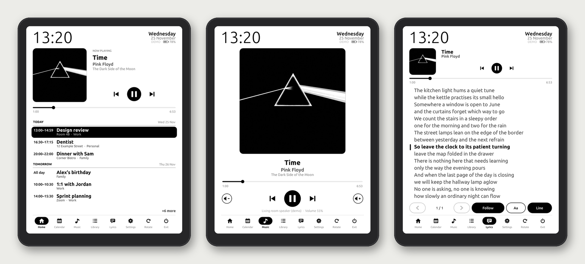
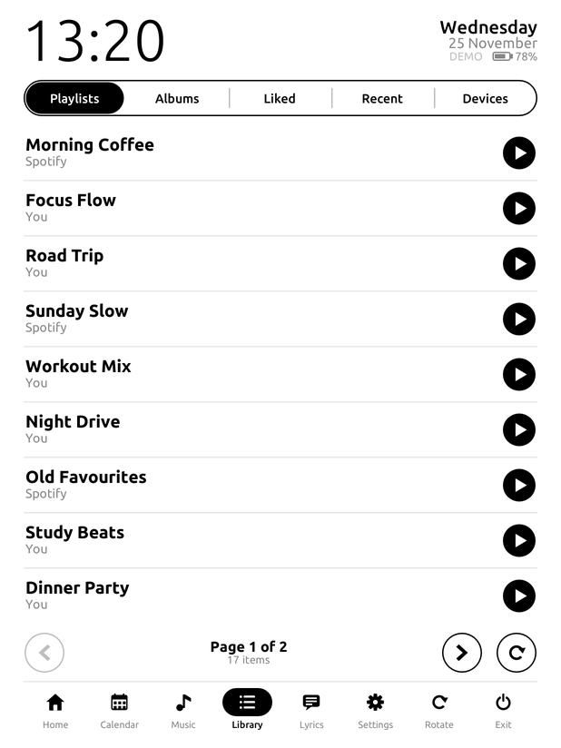
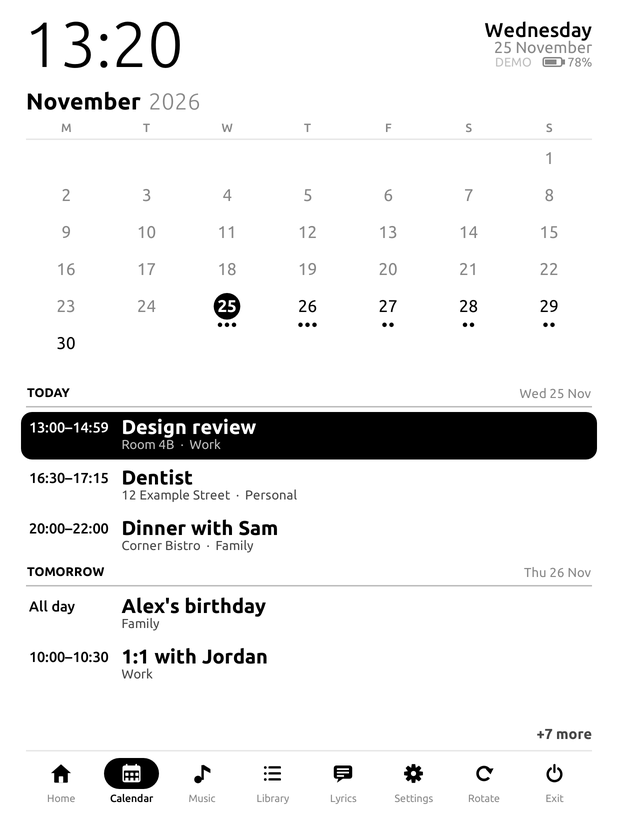
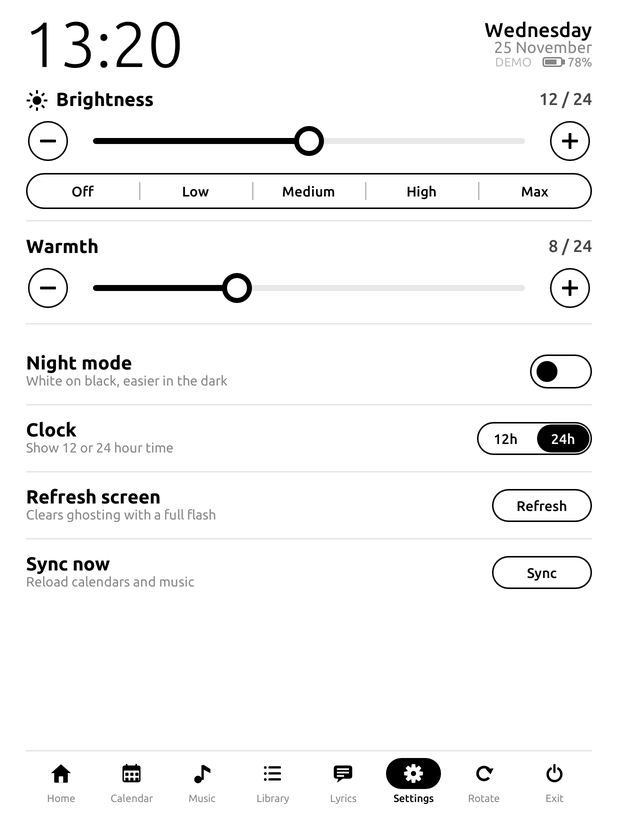
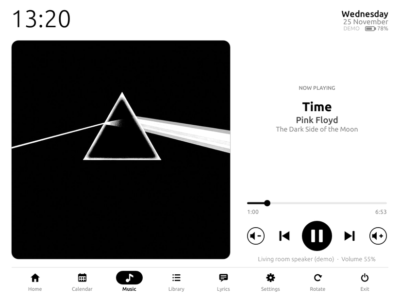

# Kindle Dash

**Your calendar, Spotify and synced lyrics on a jailbroken Kindle.** It runs entirely on the Kindle, with no server
and no computer left switched on, and everything is drawn for a slow e-ink screen.



*Simulator screenshots with demo data. Album artwork belongs to its rights holders and is shown only to illustrate the interface; the calendar events and the lyrics are made up.*

## What it does

* **Music**: the album cover is the centrepiece. Play, pause, skip, volume. **Tap or drag on the progress line to jump
  to any point in the song.**
* **Next cover ready in time:** when Spotify tells the app what plays next (albums, your own playlists, songs you queued), the next song's cover and title go up a few seconds before it starts. Spotify hides that for playlists you do not own, so then the app asks again right when the song ends and every second after, and the new song appears within a couple of seconds instead of at the next 10-second check.
* **Lyrics**: synced lyrics a page at a time with the cover and controls on top. The highlighted line moves a moment
  *before* it is sung, because e-ink needs time to redraw, and pages turn only after the last line has been sung.
* **Library**: browse your playlists, albums, liked songs, recent plays and Spotify devices, and tap to play.
* **Calendar**: browse any month (a year back, two years ahead) from any number of Google calendars. Tap a day to see its events, step day by day with the arrows, tap an event for its time, place and full description. Today's current event is inverted.
* **Home**: now playing and today's agenda on one screen.
* **Settings**: front light and warm light, night mode (inverted), 12/24-hour clock, force a clean refresh.
* Portrait and both landscape orientations. It remembers where you were.
* Made for a slow screen: redraws are batched, only the parts that changed are updated, and the progress bar moves
  in 15-second steps instead of flickering every second.

<table><tr>
<td></td>
<td></td>
<td></td>
<td></td>
</tr></table>

## What you need

* A **jailbroken Kindle** that can launch scripts from its library (KOReader is started the same way). It was built
  and tested on a **Kindle Paperwhite 5 (11th generation), firmware 5.19.2**. Other touch Kindles may work; the
  touchscreen and front light are detected automatically, and reports are welcome. A guide for jailbreaking is at
  [kindlemodding.org](https://kindlemodding.org/jailbreaking/). Jailbreaking is at your own risk.
* **Wi-Fi** on the Kindle.
* For music: **Spotify Premium** (Spotify only lets Premium accounts control playback) and about two minutes to create
  your own free Spotify app (below).
* For the calendar: Google Calendar (or any iCal feed).

## Install

1. **Download** the installer for your computer from the
   [latest release](https://github.com/TomasUribe/kindle-dash/releases/latest) and unzip it:
   `kdash-setup-windows-amd64.zip`, `kdash-setup-darwin-arm64.zip` (Macs with Apple silicon),
   `kdash-setup-darwin-amd64.zip` (Intel Macs), `kdash-setup-linux-amd64.zip` or `kdash-setup-linux-arm64.zip`.
   It is one file with everything inside, so there is nothing else to install.
2. **Plug in the Kindle** with its USB cable, wait until it appears as a drive, and **run the installer**
   (double-click on Windows; in a terminal on Mac and Linux). It finds the Kindle by itself and asks a few
   questions:
   * your **Spotify Client ID** (see below), then it opens **Spotify's own login page** in your browser, where you
     click *Agree*;
   * the **secret address of each Google calendar** you want to show (see below);
   * your **time zone** (it guesses).
3. **Eject** the Kindle on the computer, unplug it, and on the Kindle's home screen open **Kindle Dash Diagnose**
   once. It checks Wi-Fi, Spotify and your calendars and shows the result. Then open **Kindle Dash**.

> **Mac and Windows warn about unsigned programs.** Windows: *More info*, then *Run anyway*. macOS: right-click the
> file, *Open*, or run `xattr -d com.apple.quarantine kdash-setup-darwin-arm64` in a terminal. Every download is
> listed in `SHA256SUMS` on the release page, and you can build the installer yourself from this source (see below).

### Create your Spotify app (two minutes, free)

Spotify requires each person to register their own small app, so no one's key is shared and no one's quota is used up.

1. Go to <https://developer.spotify.com/dashboard> and log in.
2. **Create app**. Any name and description. Under *Redirect URIs* add exactly
   `http://127.0.0.1:8888/callback`. Tick **Web API**, accept the terms, save.
3. Open the app's **Settings** and copy the **Client ID**. Paste it into the installer when asked.

The Client ID is not a secret. Spotify's developer mode allows only a handful of users per app, which is fine for
your own account.

### Get a calendar's secret address

On a computer, in Google Calendar: **Settings**, click the calendar's name on the left, **Integrate calendar**, and
copy **Secret address in iCal format**. Paste it into the installer; it checks that it works and shows how many events
it found, and never prints the address back. Repeat for each calendar. Treat the address like a password: anyone who has
it can read that calendar, and *Reset* next to it in Google Calendar cancels it.

## Using it

| | |
|---|---|
| Tap | Press a button, a row, or a tab at the bottom. |
| **Tap or drag on the progress line** | Jump to that point in the song. |
| Swipe left / right | Next / previous screen. |
| **Calendar** screen | ‹ › change month, **Today** jumps back, tap a day to list it (‹ › then step day by day), tap an event to open it, **Back** returns. Long lists and descriptions have page buttons. |
| **Rotate** tab | Portrait, landscape, landscape the other way. |
| **Exit** tab or the power button | Back to the normal Kindle home screen. |
| Plug in the USB cable | Also closes it, so the Kindle can be a USB drive again. |
| Stuck? | Hold the power button about 40 seconds. Nothing starts at boot, so a restart always gives the normal Kindle. |

On the Lyrics screen, **Follow** keeps the page with the song, **Aa** changes the text size, and **Line** marks the
line being sung.

## Updating, changing settings, removing

Run the installer again with the Kindle plugged in. It offers to **update just the program** and keep your settings and
logins, or to set everything up again. From a terminal you can also use `-update`, `-remove` (takes it all off the
Kindle again), `-out FOLDER` (write the files to a folder instead of a Kindle) and `-help`.

A Spotify login can eventually expire, or stop working if you remove the app's access in your Spotify account. If the
music stops working, run the installer again.
More settings are in [docs/CONFIG.md](docs/CONFIG.md).

## Privacy

There is no server and no tracking. Your Spotify login and your calendar addresses are stored **on your Kindle**, and
nowhere else. The Kindle talks to Spotify, Google Calendar and [LRCLIB](https://lrclib.net) (lyrics) directly; LRCLIB is
sent the song's title, artist, album and length, and you can turn that off with `"lyrics": false` in `config.json`.
Anyone who can plug your Kindle into a computer can read what is stored on it. Details and how to revoke access are in
[SECURITY.md](SECURITY.md).

## Troubleshooting

| Problem | What to try |
|---|---|
| The installer cannot find the Kindle | Wait a little after plugging in until it shows as a drive; the Kindle must be in USB mode. Or pass the drive's folder: `-kindle /path/to/Kindle`. |
| "Kindle Dash" is missing from the library | Eject and wait a minute; the library rescans. The Kindle must be jailbroken so the library can run scripts. |
| Diagnose says Spotify has no login | Run the installer again and finish the browser step. |
| "No active Spotify device" | Start playing something in the Spotify app on any device once; the Kindle only controls Spotify, it does not play sound. |
| The login page says the redirect URI is invalid | In your Spotify app's settings the redirect URI must be exactly `http://127.0.0.1:8888/callback`. |
| Port 8888 is busy during setup | Close whatever uses it, then run the installer again. |
| Calendar events are missing | Use the *secret* iCal address, not the public one. Birthdays and holidays calendars are separate calendars with their own address. |
| Wrong times | Check `timezone` in `config.json` (see docs/CONFIG.md). |
| Ghosting on the screen | Settings, **Refresh**. A clean flash also happens every 40 updates. |

The program writes `kdash.log` and `launcher.log` in the Kindle's `kindle-dash` folder. They contain no calendar
addresses or tokens (only track titles, for the lyrics lookups).

## Try it without a Kindle

You need [Go](https://go.dev/dl/) (the version in `app/go.mod`).

```sh
cd app
go run . -demo -sim 127.0.0.1:8790     # then open http://127.0.0.1:8790 : clickable demo with fake data
go run . -demo -render ../shots        # write a PNG of every screen in both orientations
KDASH_DEMO_COVER=cover.png go run . -demo -sim 127.0.0.1:8790   # use any picture as the demo album cover
go test ./...
```

## Build the installers yourself

```sh
tools/build-release.sh 1.0.0   # needs Go, zip and gzip; writes dist/kdash-setup-*.zip
```

The ARM program for the Kindle is built with `GOOS=linux GOARCH=arm GOARM=7`, statically, and embedded in each
installer together with the launcher scripts and certificate list from
[`app/cmd/kdash-setup/payload`](app/cmd/kdash-setup/payload).

### How it is put together

* `app/` is the Kindle program (Go, no CGO). It fetches iCal feeds and uses the Spotify Web API directly, draws each
  screen itself (`render.go`, `screen_*.go`, `widgets.go`), shows it with the jailbreak's `fbink` and reads touches from
  `/dev/input`. One goroutine owns the state; see `app.go`.
* `app/cmd/kdash-setup/` is the installer: Spotify PKCE login, calendar check, Kindle detection, file copy.
* `app/display.go` updates only the rectangles that changed and flashes the whole screen every so often.
* `app/sim.go` is the browser simulator used for development and for the screenshots.

Pull requests and bug reports are welcome. Please never paste tokens or calendar addresses into an issue.

## Licence

[MIT](LICENSE). Fonts, libraries and services are listed in [THIRD_PARTY.md](THIRD_PARTY.md). Not affiliated with
Amazon, Spotify or Google.
